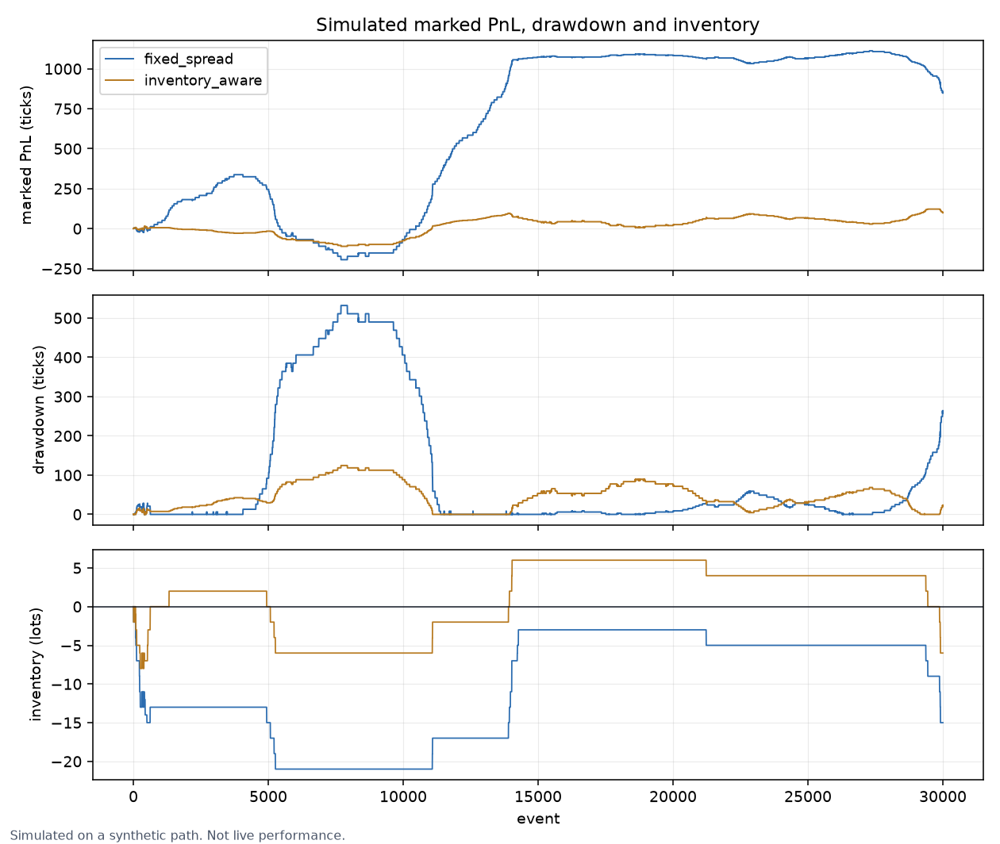
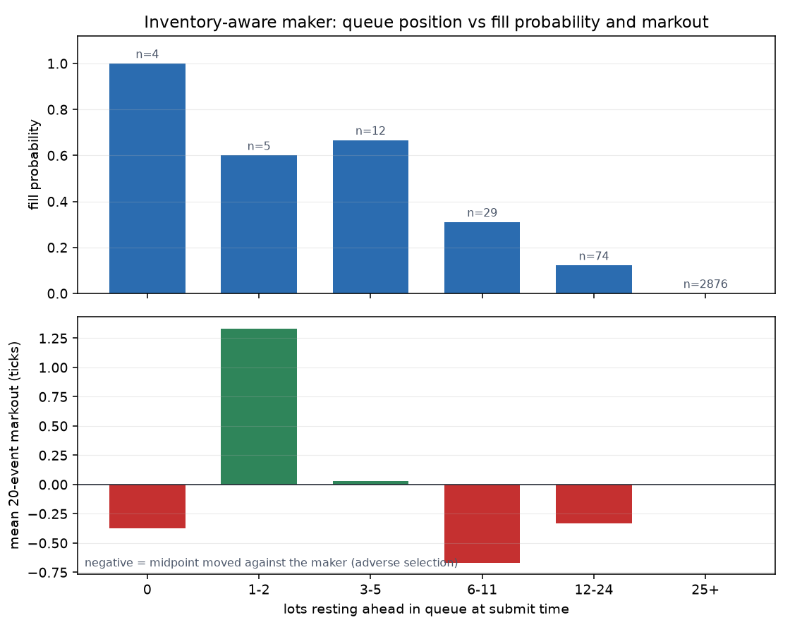

# MicroBook Quant

A queue- and latency-aware market-making research environment built around a
price-time-priority matching engine and checksum-verified real exchange data.

Most portfolio backtests assume a fill when a bar touches a price. MicroBook
models the harder questions: how much quantity was ahead in the queue, whether
a cancel arrived in time, which resting order was the maker, what inventory was
carried, and whether a fill was followed by adverse price movement.

## What it demonstrates

- **Exchange mechanics:** integer ticks, FIFO queues, partial fills, market
  orders, owner-checked cancellation, and post-only rejection.
- **Real market data:** public Kraken v2 BTC/USD snapshots, updates, and trades
  are normalized to integer ticks and recorded atomically as gzip JSONL.
- **Feed integrity:** every snapshot and update is reconstructed and checked
  against Kraken's top-ten-level CRC32 before it is accepted.
- **Discrete-event simulation:** agent actions arrive after configurable
  latency and can only trade against book state at arrival time.
- **Synthetic microstructure:** a latent fundamental, mildly informed noise
  flow, limit-order replenishment, cancellation, and endogenous top-of-book.
- **Market-making research:** a fixed-spread baseline versus an
  Avellaneda-Stoikov-inspired reservation-price strategy.
- **Execution analytics:** maker rebates, 20-event markouts, fill quantity,
  quote acceptance, inventory RMS, peak inventory, drawdown, and marked PnL,
  reduced with numpy/pandas.
- **Queue-position research:** per-quote records of how many lots were resting
  ahead at submit time, joined against realized fills and post-fill markouts.
- **Columnar storage:** captures re-encode to parquet via pyarrow for analysis,
  alongside the gzip JSONL that stays the authoritative record.
- **Reproducibility:** deterministic replay revalidates checksums, book
  invariants, latency, spread, depth imbalance, and trade statistics; CI fails
  if any figure quoted below stops matching the pipeline.

## Resume highlights

- Built a deterministic exchange simulator with price-time priority, FIFO
  queues, partial fills, market orders, cancellations, and post-only checks.
- Integrated Kraken's public BTC/USD feed and replayed **1,829 real L2 and
  trade events** with **1,807 verified checksums** and zero crossed-book states.
- Modeled queue position, order latency, maker rebates, inventory exposure,
  drawdown, and post-fill price movement instead of assuming instant fills; on
  the seeded path the `inventory_aware` policy's fill probability falls from
  **1.00 at the front of the queue to 0.00 past 25 lots deep** — a strong
  decline, but not monotone: the 3-5-lot bucket (0.667, n=12) sits above the
  1-2-lot bucket (0.600, n=5). The fall is uninterrupted from the 3-5 bucket
  down, and most filled buckets show a negative post-fill markout.
- Compared two market-making policies over 30,000 seeded events; the
  inventory-aware policy reduced peak inventory by **61.9%** and simulated
  maximum drawdown by **76.6%**.
- Kept the matching engine exact integer-tick arithmetic while moving analytics
  to numpy/pandas/pyarrow, verifying the migration left every published figure
  bitwise unchanged except one documented 1-ulp diagnostic, and that results are
  bit-identical across Python 3.11/numpy 2.4 and 3.13/numpy 2.5.
- Cross-validated fill logic against an independently written reference engine
  over a 4,000-event randomized fuzz (identical fills and top-of-book after
  every event).

## Real-feed evidence

The checked-in capture contains 89.45 seconds of public BTC/USD depth-10 and
trade data recorded on July 16, 2026.

| Integrity / market metric | Result |
| --- | ---: |
| Normalized events | 1,829 |
| L2 updates | 1,806 |
| Trades | 22 |
| Exchange CRC32s verified | **1,807** |
| Crossed-book states | **0** |
| Update throughput | 20.19 events/sec |
| Spread, p50 / p95 / max | 1 / 1 / 117 ticks |
| Receive latency, p50 / p95 | 79.30 / 94.52 ms |
| Mean depth imbalance | -0.534 |
| Midpoint change RMS | 2.04 ticks |
| Traded quantity / notional | 0.13212592 BTC / $8,533.15 |

Every figure in this table is asserted by
[`scripts/check_documented_metrics.py`](scripts/check_documented_metrics.py),
which CI runs against a freshly replayed capture — so these numbers cannot go
stale without breaking the build.

[`artifacts/kraken_l2_sample.jsonl.gz`](artifacts/kraken_l2_sample.jsonl.gz)
is identified by SHA-256
`97bd818113f75a9d44517969d64c72e08ba0bacb3a749f420e8fbdbf6cbf979e`.
[`artifacts/kraken_replay.json`](artifacts/kraken_replay.json) is regenerated
from that capture and does not trust stored summary values.

## Event path

```text
latent fundamental ----> external limit / market order flow
                                  |
                                  v
                       price-time-priority book
                                  |
                    fills + queue-position outcome
                                  |
         +------------------------+-----------------------+
         |                                                |
 inventory / cash / markout                    delayed quote actions
         |                                                ^
         +----> strategy observes midpoint + volatility --+
                         configurable latency
```

## Simulated strategy experiment

30,000 events, seed 31, quote refresh every 20 events, three-event action
latency. Reproduce with
`python -m microbook simulate --events 30000 --seed 31 --output artifacts --artifacts`.

| Metric | Fixed spread | Inventory aware |
| --- | ---: | ---: |
| Final marked PnL (ticks) | 848.64 | 99.12 |
| Maximum drawdown (ticks) | 531.98 | **124.47** |
| Peak absolute inventory | 21 | **8** |
| RMS inventory | 12.43 | **4.65** |
| Ending inventory | -15 | **-6** |
| Maker fills | 48 | 42 |

The inventory-aware policy reduces peak inventory by **61.9%** and simulated
maximum drawdown by **76.6%**. It does not dominate the baseline: the
fixed-spread policy earns more on this synthetic path while carrying materially
larger directional exposure. No simulated PnL is presented as live performance.

The checked-in [`artifacts/comparison.json`](artifacts/comparison.json) contains
the full result, including quote acceptance and post-fill markouts.



## Queue position drives fills and adverse selection

Every agent quote that rests on the book records how many lots were already
ahead of it in its FIFO queue at submit time. That number is only knowable at
submission, so it is captured by the event loop and reduced afterwards in pandas.
Inventory-aware policy, same 30,000-event seeded path:

| Lots ahead in queue | Quotes | Filled | Fill probability | Mean 20-event markout (ticks) |
| --- | ---: | ---: | ---: | ---: |
| 0 | 4 | 4 | 1.000 | -0.375 |
| 1-2 | 5 | 3 | 0.600 | +1.333 |
| 3-5 | 12 | 8 | 0.667 | +0.031 |
| 6-11 | 29 | 9 | 0.310 | -0.667 |
| 12-24 | 74 | 9 | 0.122 | -0.333 |
| 25+ | 2,876 | 0 | 0.000 | n/a |



Fill probability declines strongly with queue depth, but it is *not* monotone
across every bucket: the 3-5 bucket (0.667) is above the 1-2 bucket (0.600),
because those shallow buckets hold 5 and 12 quotes respectively and a single fill
moves them several points. From the 3-5 bucket downwards the decline is
uninterrupted, and past 25 lots deep nothing fills at all on this path — which is
why 2,876 of the 3,000 quotes never trade. The small-sample buckets (n=4, n=5)
carry wide error bars and should not be read as a sign that joining an empty
level is free; the honest reading is that fills concentrate at the front of the
queue and that most of the filled buckets show a *negative* markout, i.e. the
midpoint moved against the maker after the fill.

## Numerics: integers in the book, numpy in the analysis

This split is deliberate and is the one architectural line in the project.

**The matching engine and the event loop are integer and scalar.**
[`src/microbook/book.py`](src/microbook/book.py) is pure-stdlib: prices are
integer ticks, sizes are integer lots, and events are sequenced one at a time.
That is not an un-optimized leftover:

- Price-time priority, queue position and partial fills are *order dependent*.
  There is no correct way to vectorize "which resting order was the maker"
  across events, because the answer to each event depends on the previous one.
- Float prices make tick comparisons ambiguous. "Is this order at the touch?"
  and "would this post-only quote cross?" are exact integer comparisons; a
  1-ulp error there silently changes which order is the maker and therefore who
  earned the rebate.

**The analytics layer is vectorized.**
[`src/microbook/analytics.py`](src/microbook/analytics.py) consumes what a run
recorded — PnL curves, per-quote records, markouts, per-event book observations —
and reduces them with numpy/pandas. That is where vectorization actually pays.

**Where money is summed, summation is order-independent.** Aggregates over
monetary quantities use `math.fsum` (exactly rounded, so permutation-invariant)
rather than a pairwise numpy reduction whose result depends on array chunking.
`np.maximum.accumulate` and `np.diff` are used freely, because they perform
selection and one subtraction per element and are therefore bitwise identical to
the equivalent scalar loop. Inventory RMS sums squares in exact `int64` before
the single final divide.

Migrating the analytics to numpy left **every** published figure bitwise
unchanged, with one exception: `depth_imbalance_mean` moved by 1 ulp
(`-0.5335132040751039` to `-0.5335132040751038`) because `statistics.mean` sums
via exact rationals while `math.fsum` rounds once at the end. It is a
dimensionless diagnostic statistic, not money, so the `fsum` result is kept for
order-independence and the tolerance is pinned in
[`scripts/check_documented_metrics.py`](scripts/check_documented_metrics.py).
`tests/test_analytics.py` locks each vectorized reduction to the scalar stdlib
result it replaced.

The payoff is portability of results: the full pipeline was run under Python
3.11 / numpy 2.4.6 and Python 3.13 / numpy 2.5.1 and produced **bit-identical**
output, including the strategy comparison and every queue-position bucket.

## Storage: JSONL for capture, parquet for analysis

`gzip` JSONL remains the **capture** format: append-only, one self-describing
record per line, survives a truncated write, and — critically — preserves the
exact decimal quantity *strings* Kraken sent. The CRC32 is computed over those
strings, so round-tripping a quantity through a float would break checksum
reproduction.

Parquet is the **analysis** format, written by
[`src/microbook/storage.py`](src/microbook/storage.py): columnar, typed, and
directly loadable into pandas. Prices cross into parquet as `int64` ticks, never
floats; timestamps stay `int64` nanoseconds. Quantities keep their original
string form with a derived `float64` column alongside for convenience, so a book
image read back out of parquet still reproduces the exchange checksum — asserted
by `tests/test_storage.py`.

On this 1,829-event sample the three parquet files total 129 KB against the
43 KB gzip JSONL: parquet is *larger* here, because per-column dictionaries and
metadata dominate at this size and the top-of-book table is derived data the
JSONL does not carry. The columnar win is in typed zero-parse loading and
predicate pushdown, and in compression only at sizes far above a 90-second
sample. Parquet output is gitignored and regenerated on demand.

## Validation against an independent engine

`tests/test_matching_reference.py` cross-checks the matching engine against a
deliberately naive reference book written independently of `book.py` — a flat
list of resting orders scanned in `(price, arrival)` order. It is far too slow
to be the engine, which is exactly what makes it a useful oracle: it shares no
code, no data structures and no optimizations with the implementation. A 4,000-
event randomized fuzz (limit and market orders, cancels, multi-level sweeps)
asserts identical fills and identical top-of-book after **every** event.

`nautilus_trader` was evaluated for this role and rejected: its matching engine
is no longer an importable Python module (it moved to a Rust/pyo3 extension), so
there is nothing to call at the fill-logic level without standing up a full
backtest node, and it pins `pandas<3.0.0`, which would downgrade the pandas this
project resolves.

## Run it

Requires Python 3.11+ (numpy 2.1 and pandas 2.2 both dropped 3.10).

```powershell
python -m venv .venv
.venv\Scripts\python -m pip install -e ".[dev]"
```

```powershell
# Revalidate the committed capture; optionally emit parquet and a figure.
python -m microbook replay artifacts/kraken_l2_sample.jsonl.gz `
  --parquet-dir artifacts/columnar `
  --figure artifacts/kraken_microstructure.png

# Seeded paired strategy comparison; --artifacts adds parquet + figures.
python -m microbook simulate --events 30000 --seed 31 --output artifacts --artifacts
```

To record a fresh public sample:

```powershell
python -m pip install -e ".[live]"
microbook capture --symbol "BTC/USD" --depth 10 --seconds 90
```

For development:

```powershell
pytest
ruff check .
python scripts/check_documented_metrics.py artifacts/kraken_replay.json
```

### Dependencies

Runtime dependencies cover the **analysis** layer only. The matching engine and
the simulator event loop are pure stdlib by design — see "Numerics" above.

| Package | Constraint | Used for |
| --- | --- | --- |
| numpy | `>=2.1` | vectorized path/percentile/histogram reductions |
| pandas | `>=2.2` | quote, markout and queue-position frames |
| pyarrow | `>=17` | columnar parquet capture and run output |
| matplotlib | `>=3.9` | figures in `artifacts/` (headless `Agg`) |
| websockets | `>=13` (`[live]`) | live Kraken v2 feed |
| pytest, ruff | `[dev]` | tests and lint |

Resolved on Python 3.11.9 at the time of writing: numpy 2.4.6, pandas 3.0.5,
pyarrow 25.0.0, matplotlib 3.11.1.

## Repository map

```text
src/microbook/
  book.py        matching engine and invariants   <- integer ticks, pure stdlib
  simulator.py   exchange event loop, latency, accounting, markouts  <- scalar
  strategy.py    fixed and inventory-aware quote policies
  feeds/
    kraken.py    normalized events and CRC32 book reconstruction
    kraken_recorder.py atomic public WebSocket recorder
    coinbase.py  authenticated Coinbase L2 normalization
  replay.py      deterministic integrity and microstructure analytics
  analytics.py   vectorized reductions            <- numpy / pandas
  storage.py     columnar parquet schemas + writers  <- pyarrow
  plots.py       matplotlib figures
  experiment.py  reproducible paired comparison
scripts/
  check_documented_metrics.py  fails CI if a README figure goes stale
tests/            FIFO, partial fill, cancellation, latency, risk, parity,
                  parquet round-trip, and reference-engine fuzz tests
```

The `<-` annotations mark the integer/float boundary: `book.py`, `simulator.py`
and the feed normalizers do exact integer arithmetic, while `analytics.py`,
`storage.py` and `plots.py` do floating-point aggregation of already-recorded
results.

## Modeling choices

Real feed prices are converted to exact integer ticks while decimal quantity
strings are retained for exchange checksum reproduction. The synthetic
simulator uses integer prices and lots. Its latent fundamental biases public
order flow but is never visible to either strategy.

The `pnl_path_ratio_100_event` field is
`sqrt(N) * mean(increment) / std(increment)` on 100-event marked-PnL
increments. It is a path-comparison statistic, not an annualized Sharpe ratio.

Queue-position buckets are left-closed, so "joined an empty level" (zero lots
ahead) is its own bucket rather than being merged into "1-2". The two smallest
buckets hold single-digit sample counts on a 30,000-event path; the per-bucket
`orders` column is reported alongside every probability so the reader can see
which cells are thin.

## Research context

The project direction is informed by the queue-position and latency realism in
[hftbacktest](https://github.com/nkaz001/hftbacktest) and by classic
inventory-aware market-making models. The implementation here is standalone,
small enough to audit, and deliberately exposes the exchange mechanics rather
than hiding them behind a backtesting framework.
